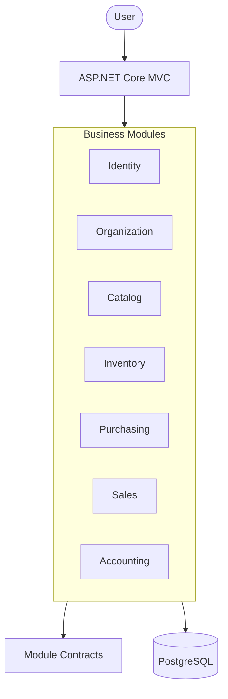
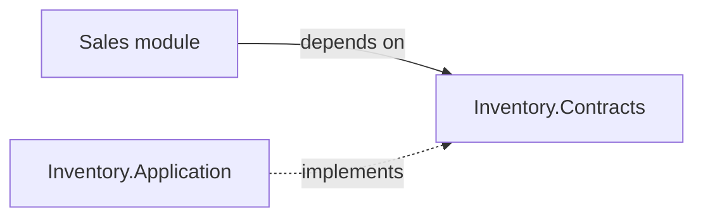

# Stocka ERP

### Multi-Organization & Multi-Branch ERP System

[](https://dotnet.microsoft.com/)
[](https://learn.microsoft.com/aspnet/core)
[](https://www.postgresql.org/)
[]()

Stocka is an ERP system that helps small and medium-sized retail businesses manage their daily operations from one place: products, stock, purchasing, sales, and accounting records.

> **Status:** Stocka is a rebuild of an earlier project, with a new architecture and a new user interface. It is under active development, and not every module is complete. See [Modules](#modules) for the current picture.

---

## Why Stocka?

Many small and medium businesses run their day-to-day work on Excel or Access sheets: sales, purchases, suppliers, stock levels, even daily journal entries. This works until it doesn't. Data gets duplicated, nothing is validated, reports are built by hand, and the numbers are hard to trust.

Stocka replaces those sheets for the retail side of the business: buying, storing, and selling goods. It puts everything in one stable system, with clear reports, and without requiring users to know Excel or Access to manage it.

Stocka is not meant to replace every spreadsheet. Some domains are large or flexible enough that they deserve their own dedicated application. Stocka focuses on the operations that most retail businesses share.

Main goals:

- Manage multiple organizations from one account.
- Manage several branches within each organization.
- Keep each organization's data fully separated from the others.
- Cover products, inventory, purchasing, sales, and accounting in one place.
- Stay simple to use and easy to grow as business needs change.

---

## Modules

| Module | Description | Status |
|---|---|---|
| Identity | User accounts and authentication | TBD |
| Organization | Organizations, branches, and memberships | TBD |
| Catalog | Products and product categories | TBD |
| Inventory | Stock, warehouses, batches, and stock movements | TBD |
| Purchasing | Purchase operations and received items | TBD |
| Sales | Sales operations and POS | TBD |
| Accounting | Financial records and transactions | TBD |
| Income & Expenses | Business income and expense tracking | TBD |

> Status values will be filled in as the rebuild progresses (Planned / In Progress / Done).

---

## Architecture & Design

Stocka is a **Modular Monolith**. The system is divided into modules by business responsibility, and everything runs as one deployable application.

Each module is a complete Clean Architecture on its own:

```text
Module/
├── Domain/           Entities, value objects, domain rules
├── Application/      Use cases (commands/queries), repository interfaces
├── Infrastructure/   EF Core, Dapper, database access
└── Contracts/        Public interfaces and DTOs for other modules
```

### Overview



*The diagram shows the architectural direction. Module implementation is still in progress.*

### Main Design Approaches

| Approach | Purpose |
|---|---|
| Modular Monolith | Separate the system into independent business modules |
| Clean Architecture | Keep business logic independent from infrastructure |
| Domain-Driven Design | Organize the domain around business concepts |
| CQRS | Separate write operations from read operations |
| MediatR | Dispatch application commands and queries |

### Communication Between Modules

Modules never access each other's internals. Each module exposes a **Contracts** layer that contains:

- **Interfaces** describing what the module offers to others. They are implemented in the module's own Application layer.
- **DTOs** returned by those interfaces.

When a module needs something from another module, it depends only on that module's Contracts, and the implementation is resolved through dependency injection. It cannot see the other module's Domain, Application, or Infrastructure code.



---

## Organization & Access Model

Stocka is multi-tenant. The **organization** is the boundary that separates one business's data from another's.

- **Organization:** a business using Stocka.
- **Branch:** a branch that belongs to an organization.
- **Organization Membership:** connects a user account to an organization and defines the user's role there. A user can belong to more than one organization, with a different role in each.
- **Party:** shared information about a person or business contact.
- **Party Organization:** connects a party to an organization for business purposes.

This model separates user permissions from business relationships. For example, a user may be an employee in one organization while being a customer in another.

### Tenant Isolation

Everything a business owns is tied to a specific organization: products, categories, people, warehouses, batches, stock movements, purchases, and sales. Data from one organization is never meant to be visible to another.

The active user, organization, branch, and roles are resolved per request through dependency injection, so use cases do not need to pass them around manually.

Read queries require the organization id as a mandatory parameter, and each query includes it in its SQL filter. Write operations load tracked entities and modify them through EF Core.

---

## Data Access (CQRS)

Reads and writes use separate repositories and separate tools:

| Side | Tool | Used for |
|---|---|---|
| Write | Entity Framework Core | Create, update, delete, and loading tracked entities to modify them |
| Read | Dapper | All queries, lists, lookups, and reports |

- **Write repositories** work with domain entities. Simple lookups there exist only to support modifying an entity.
- **Read repositories** are organized per table (or per report). Each has a shared base `SELECT`, and every query is defined in one place and reused wherever it is needed. Use cases do not contain SQL.

---

## Technology Stack

| Area | Technologies |
|---|---|
| Language | C# |
| Framework | .NET 10 |
| Web Application | ASP.NET Core MVC |
| Writes | Entity Framework Core |
| Reads | Dapper |
| Database | PostgreSQL |
| Application Flow | MediatR |
| Validation | FluentValidation |
| Authentication | ASP.NET Core Identity (cookies) for MVC; JWT planned for the future API |
| Authorization | Role-Based Access Control (RBAC) |

---

## Getting Started

> Setup instructions are not ready yet. The application is still in active development, and Docker support has not been added.

Planned for this section:

- Prerequisites (.NET 10 SDK, PostgreSQL)
- Configuration and environment variables
- Running the application locally
- Docker Compose setup

*TODO: fill in once the setup is stable.*

---

## Project Structure

A simplified view of the intended structure:

```text
Stocka/
│
├── Modules/
│   ├── Identity/
│   │   ├── Domain/
│   │   ├── Application/
│   │   ├── Infrastructure/
│   │   └── Contracts/
│   │
│   ├── Organization/
│   ├── Catalog/
│   ├── Inventory/
│   ├── Purchasing/
│   ├── Sales/
│   └── Accounting/
│
├── Hosts/
│   └── Stocka.MVC/
│
└── README.md
```

*The actual structure may change during development.*

---

## Testing

Automated tests are planned. Each module will have its own tests that cover only that module's behavior.

*TODO: add test instructions once tests exist.*

---

## Screenshots

*Screenshots of the new interface will be added here once the UI is ready.*

<!-- TODO: add screenshots, e.g.  -->

---

## Roadmap

- Complete the core business modules.
- Improve inventory and warehouse workflows.
- Add automated tests for each module.
- Add an ASP.NET Core Web API as another entry point (JWT authentication).
- Build a separate frontend with Next.js and TypeScript.
- Add Docker support and improve the development and deployment setup.
- Consider EF Core global query filters as an additional safety layer for write operations.

The API and the separate frontend are not part of the current MVC application yet.

---

## License

*A license will be added here later.*

<!-- TODO: add a LICENSE file and update this section -->

---

## Author

**Fady Fayez**

Junior Full-Stack .NET Developer

- GitHub: [FadiFayezDev](https://github.com/FadiFayezDev)
- LinkedIn: [FadyFayezDev](https://www.linkedin.com/in/fadyfayezdev/)

---

*Stocka is an independent project. The current version is a rebuild of an earlier implementation and is still in progress.*
